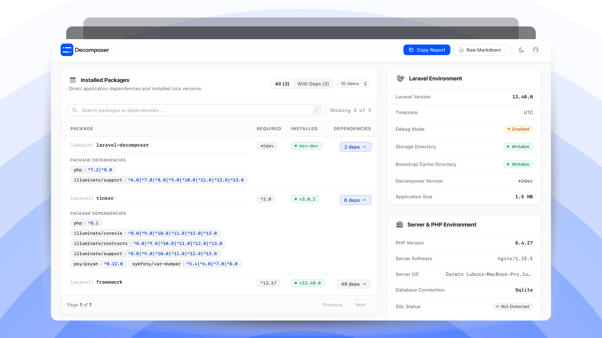

<p align="center">
  
</p>



<p>
  <a href="https://packagist.org/packages/lubusin/laravel-decomposer"></a>
  <a href="https://github.com/lubusIN/laravel-decomposer/actions/workflows/run-tests.yml"></a>
  <a href="https://packagist.org/packages/lubusin/laravel-decomposer"></a>
  <a href="https://github.com/lubusIN/laravel-decomposer/blob/master/LICENSE.txt"></a>
</p>

## Laravel Decomposer

**Laravel Decomposer** provides an instant, interactive breakdown of your Laravel application's installed packages, lock versions, and dependencies alongside deep server and framework environment details.

It also generates a standardized Markdown system report ready to copy or download for troubleshooting and GitHub issues, and provides programmatic PHP APIs to access report data as an array or JSON anywhere in your code.

## Features

- **Installed Packages & Dependencies**: View all direct dependencies, required constraints, installed lock versions, and expandable direct sub-dependencies directly in the browser.
- **Environment Diagnostics**: Inspect Laravel version, timezone, debug mode, directory permissions (`storage`, `bootstrap/cache`), app size, server software, PHP version, and loaded core extensions (OpenSSL, PDO, Mbstring, Tokenizer, XML).
- **One-Click Markdown Report**: Generate, copy, or download a structured system report formatted for GitHub issues, issue trackers, and customer support tickets.
- **Programmatic API**: Retrieve the system report as a native PHP array or JSON payload anywhere in your application or CLI commands.
- **Extensible Stats**: Register custom application, Laravel, or server metrics via `Decomposer::addExtraStats()`, `addLaravelStats()`, and `addServerStats()`.
- **Modern Dashboard UI**: Built with Tailwind CSS and Alpine.js, featuring real-time package search, hotkey search (`/`), dependency filters, pagination, and built-in light & dark mode.

## Requirements & Compatibility

- **PHP**: `^8.2` (PHP 8.2, 8.3, 8.4)
- **Laravel**: `11.x`, `12.x`, and `13.x`

## Installation

### 1. Install via Composer

```bash
composer require lubusin/laravel-decomposer
```

### 2. Publish Dashboard Assets

Publish the compiled stylesheet and JavaScript bundle to your application's `public` directory:

```bash
php artisan vendor:publish --tag=DecomposerAssets --force
```

### 3. Publish Configuration (Optional)

```bash
php artisan vendor:publish --tag=DecomposerConfig
```

This creates `config/decomposer.php`, where you can configure directories to exclude when calculating total application size:

```php
return [
    'exclude_folders' => [
        'vendor',
        'node_modules',
        'storage',
        'tests',
        '.git',
    ],
];
```

### 4. Register the Route

Add the Decomposer route to your `routes/web.php`. We recommend protecting this route with authentication or authorization middleware in production environments:

```php
use Lubusin\Decomposer\Controllers\DecomposerController;

// Development / Local:
Route::get('decompose', [DecomposerController::class, 'index']);

// Recommended for Production:
Route::get('decompose', [DecomposerController::class, 'index'])
    ->middleware(['web', 'auth']);
```

### 5. Access the Dashboard

Open `https://your-app.test/decompose` (or your configured path) in your browser.

## Usage 

The Docs can be found in the [Wiki](https://github.com/lubusIN/laravel-decomposer/wiki) but to save you one more click, here's the index

- [Add your own extra stats for your package or app](https://github.com/lubusIN/laravel-decomposer/wiki/Add-your-extra-stats)
- [Get Decomposer report as markdown](https://github.com/lubusIN/laravel-decomposer/wiki/Get-Markdown-Report)
- [Get Decomposer report as an array](https://github.com/lubusIN/laravel-decomposer/wiki/Get-Report-as-an-array)
- [Get Decomposer report as JSON](https://github.com/lubusIN/laravel-decomposer/wiki/Get-Report-as-JSON)


## Local Development & Contributing

Thank you for considering contributing to Laravel Decomposer! Please review the [contribution guidelines](contributing.md).

### Setup for Local Package Development

1. Clone the repository:
   ```bash
   git clone git@github.com:lubusIN/laravel-decomposer.git
   cd laravel-decomposer
   ```

2. Install PHP and Node dependencies:
   ```bash
   composer install
   npm install
   ```

3. Compile frontend assets:
   ```bash
   npm run build
   # Or for active development:
   npm run dev
   ```

4. Run tests and code style checks:
   ```bash
   composer test   # Runs Pest test suite
   composer lint   # Checks formatting with Laravel Pint
   composer format # Auto-fixes formatting with Laravel Pint
   ```

### Security

If you discover a security vulnerability within Laravel Decomposer, please email [info@lubus.in](mailto:info@lubus.in). All security issues will be promptly addressed.

## Meet Your Artisans

**[LUBUS](https://lubus.in/?utm_source=github&utm_medium=open-source&utm_campaign=laravel-decomposer)** is a web design and development agency based in Mumbai, India.

<a href="https://cal.com/lubus">
  
</a>

## License

Laravel Decomposer is open-sourced software licensed under the [MIT license](LICENSE.txt).
